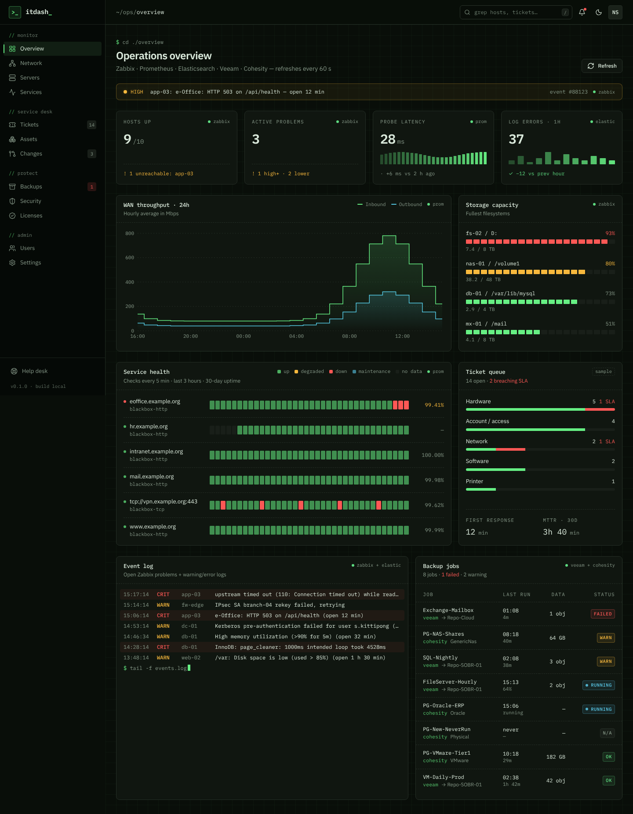

# ITDash

Dashboard ภาพรวมงานไอทีขององค์กร — สถานะเครื่อง, ปัญหาที่เปิดอยู่, traffic WAN, บริการ, log และ backup ในหน้าเดียว
ดึงข้อมูลจริงจาก **Zabbix, Prometheus, Elasticsearch, Veeam B&R และ Cohesity** แบบอ่านอย่างเดียว



<sub>ภาพจากการทดสอบกับ server จำลอง (`npm run dev:fake`) — ชื่อเครื่องและตัวเลขเป็นข้อมูลตัวอย่าง</sub>

## การ์ดและแหล่งข้อมูล

| การ์ด | ระบบ | รีเฟรชข้อมูลจากระบบทุก |
| --- | --- | --- |
| แถบแจ้ง incident | Zabbix (problem ระดับ High / Disaster) | 30 วินาที |
| Hosts up · Active problems | Zabbix | 30 วินาที |
| Probe latency · Service health | Prometheus (blackbox_exporter) | 30 วินาที |
| WAN throughput 24 ชม. | Prometheus (snmp / node exporter) | 5 นาที |
| Storage capacity | Zabbix (`vfs.fs.size`) | 15 นาที |
| Log errors · Event log | Elasticsearch + Zabbix | 30 วินาที |
| Backup jobs | Veeam B&R + Cohesity | 5 นาที |
| Ticket queue | — ยังไม่มีระบบ ticket (ข้อมูลตัวอย่าง) | — |

หน้าจอรีเฟรชเองทุก 60 วินาที และผู้ใช้กี่คนก็ไม่ทำให้ระบบต้นทางถูกเรียกมากขึ้น (มี cache ฝั่ง server)

**ป้ายมุมขวาของการ์ด** บอกที่มาของข้อมูล

| ป้าย | ความหมาย |
| --- | --- |
| `● zabbix` | ข้อมูลจริง |
| `sample` | ยังไม่ได้ตั้งค่าระบบนี้ — ตัวเลขเป็นตัวอย่าง |
| `● zabbix down` | เรียกระบบไม่สำเร็จ — การ์ดแสดงสาเหตุและลองใหม่ทุก 15 วินาที (ไม่แสดงตัวเลขปลอมแทน) |
| `● veeam + cohesity · partial` | การ์ดที่รวมหลายระบบ ได้ข้อมูลมาบางระบบ |

## เริ่มใช้งาน

ต้องใช้ **Node.js 20.9+** (หรือ Docker) — ฟอนต์ติดตั้งผ่าน npm จึง build ได้โดยไม่ต้องต่อ Google Fonts

**1. ดูหน้าตาด้วยข้อมูลตัวอย่าง**

```bash
npm install
npm run dev                 # http://localhost:3000
```

**2. ทดสอบกับ server จำลองของทั้ง 5 ระบบ** (ไม่ต้องมีระบบจริง)

```bash
npm run fake-sources        # terminal 1
npm run dev:fake            # terminal 2 — ใช้ค่าใน .env.fake
```

**3. ต่อระบบจริง**

```bash
cp .env.example .env.local  # ใส่ URL + token ของแต่ละระบบ
npm run build && npm start
```

**4. รันด้วย Docker**

```bash
cp .env.example .env.local
cp /path/to/ca-bundle.pem certs/     # ถ้ามีใบรับรองภายใน / self-signed
docker compose up -d --build         # http://<host>:3000
```

แก้ `.env.local` แล้วแค่ restart — ไม่ต้อง build ใหม่ · หลาย replica หลัง nginx ดู [docs/DEPLOYMENT.md](docs/DEPLOYMENT.md)

## ตั้งค่า

ตั้งทั้งหมดใน `.env.local` (ตัวอย่างครบใน [`.env.example`](.env.example)) — ระบบไหนเว้นว่าง การ์ดของระบบนั้นแสดงข้อมูลตัวอย่าง

| ระบบ | ตัวแปรหลัก |
| --- | --- |
| ทั่วไป | `DATA_SOURCE=live`, `DASH_TIMEZONE=Asia/Bangkok`, `SOURCE_TIMEOUT_MS` |
| Zabbix | `ZABBIX_URL`, `ZABBIX_TOKEN`, `ZABBIX_HOSTGROUP_IDS`, `ZABBIX_STORAGE_MIN_TB` |
| Prometheus | `PROM_URL`, `PROM_Q_WAN_IN`, `PROM_Q_WAN_OUT`, `PROM_Q_PROBE`, `PROM_Q_LATENCY`, `PROM_PROBE_NAME_LABEL` |
| Elasticsearch | `ES_URL`, `ES_API_KEY`, `ES_INDEX`, `ES_LEVEL_FIELD`, `ES_FILTER` |
| Veeam B&R | `VEEAM_URL`, `VEEAM_USERNAME`, `VEEAM_PASSWORD`, `VEEAM_API_VERSION` |
| Cohesity | `COHESITY_URL`, `COHESITY_API_KEY` |

- ใช้บัญชี/API key แบบ **read-only** ที่สร้างให้ ITDash โดยเฉพาะ — วิธีสร้างของแต่ละระบบอยู่ใน [docs/INTEGRATIONS.md](docs/INTEGRATIONS.md)
- ใบรับรองภายใน/self-signed: ตั้ง `NODE_EXTRA_CA_CERTS` **ใน environment ของ service หรือ container** ไม่ใช่ใน `.env.local`
  (Node อ่านค่านี้ก่อนโหลดไฟล์นั้น) — `compose.yaml` ตั้งไว้ให้แล้ว
- log file ต่างๆ ให้ส่งเข้า Elasticsearch ด้วย Filebeat / Winlogbeat / Elastic Agent แล้วจะขึ้นใน Event log เอง

## คำสั่ง

| คำสั่ง | ทำอะไร |
| --- | --- |
| `npm run dev` | dev server ที่ `:3000` |
| `npm run build` / `npm start` | build และรันแบบ production |
| `npm run lint` | ตรวจโค้ดด้วย ESLint |
| `npm run fake-sources` | เปิด server จำลอง Zabbix / Prometheus / Elasticsearch / Veeam / Cohesity ที่ port 4101–4105 |
| `npm run dev:fake` | dev server ที่ชี้ไปยัง server จำลอง (`.env.fake`) |
| `docker compose up -d --build` | build image และรัน 1 instance |
| `docker compose -f compose.yaml -f compose.scale.yaml up -d --build --scale itdash=3` | หลาย replica หลัง nginx ที่ `:8080` |

Health check: `GET /api/health` → `{"status":"ok"}`

## Stack

| ส่วน | ใช้อะไร |
| --- | --- |
| Framework | Next.js 16 (App Router, Cache Components, `'use cache'`), React 19, TypeScript |
| Styling | Tailwind CSS v4 + design tokens แบบ OKLCh |
| Components | รูปแบบ shadcn/ui (Radix UI + CVA + `cn()`) — เป็น source ในโปรเจกต์ แก้ได้เลย |
| Charts | Recharts (WAN throughput) + SVG/CSS (KPI strip, service matrix, storage meters) |
| อื่นๆ | lucide-react, next-themes, ฟอนต์ IBM Plex Sans / Mono / Sans Thai (Fontsource) |

## โครงสร้าง

```
├── Dockerfile · compose.yaml · compose.scale.yaml
├── deploy/nginx.conf               # load balancer สำหรับหลาย replica
├── certs/                          # CA bundle สำหรับ Docker (ไม่ขึ้น Git)
├── scripts/                        # server จำลอง + dev:fake
├── docs/                           # สถาปัตยกรรม, การเชื่อมต่อ, deploy
└── src/
    ├── app/
    │   ├── layout.tsx              # root: ฟอนต์ + ThemeProvider
    │   ├── globals.css             # design tokens (light + dark)
    │   ├── api/health/route.ts     # health check
    │   └── (dashboard)/            # ทุกหน้าในนี้ได้ sidebar + header
    │       ├── layout.tsx
    │       ├── page.tsx            # Overview — โครงหน้า + <Suspense> ต่อการ์ด
    │       └── [section]/page.tsx  # placeholder ของเมนูที่ยังไม่ได้ทำ
    ├── components/
    │   ├── ui/                     # button, card, badge, input, sheet, dropdown-menu
    │   ├── layout/                 # sidebar, header, theme-toggle
    │   └── dashboard/              # overview-cards (async), kpi-tile, charts, source-tag, ...
    └── lib/
        ├── navigation.ts           # เมนู sidebar
        ├── data/
        │   ├── types.ts            # type กลางที่ทุก adapter คืนค่า
        │   ├── index.ts            # loader ต่อการ์ด → live / sample / error
        │   └── mock.ts             # ข้อมูลตัวอย่าง
        ├── sources/                # zabbix · prometheus · elasticsearch · veeam · cohesity
        └── format.ts               # เวลา (Asia/Bangkok), ขนาด, ระยะเวลา
```

## ปรับแต่ง

**เปลี่ยนสีหลักทั้งแอป** — แก้ตัวเลขเดียวใน `src/app/globals.css`

```css
:root { --brand-h: 148; }   /* 148 = เขียว, 220 = ฟ้า, 75 = อำพัน, 300 = ม่วง */
```

**ปรับความถี่การดึงข้อมูล** — โปรไฟล์ `cacheLife` ใน `next.config.ts` (`live` 30 วินาที, `ops` 5 นาที, `slow` 15 นาที)

**เพิ่มหน้าใหม่** — สร้าง `src/app/(dashboard)/<ชื่อ>/page.tsx` (ทับ placeholder อัตโนมัติ) และเพิ่มเมนูใน `src/lib/navigation.ts`

**เพิ่มระบบใหม่** (เช่น ระบบ ticket) — เขียน adapter ใน `src/lib/sources/` ให้คืนค่าเป็น type ใน `types.ts`
แล้วต่อเข้า loader ใน `src/lib/data/index.ts` — การ์ดไม่ต้องแก้

## เอกสาร

| เอกสาร | เนื้อหา |
| --- | --- |
| [docs/ARCHITECTURE.md](docs/ARCHITECTURE.md) | ไดอะแกรมสถาปัตยกรรม, การไหลของข้อมูล, สถานะของการ์ด, การวางเครื่องในเครือข่าย |
| [docs/INTEGRATIONS.md](docs/INTEGRATIONS.md) | วิธีเชื่อมต่อแต่ละระบบ (+ log files), ทดสอบ, ตารางแก้ปัญหา, checklist ความปลอดภัย |
| [docs/DEPLOYMENT.md](docs/DEPLOYMENT.md) | Docker, ปรับโหลด, หลาย replica และข้อแลกเปลี่ยน, ผลทดสอบโหลด |

## ข้อจำกัดตอนนี้

- **ยังไม่มีระบบล็อกอิน** — ให้เปิดเฉพาะเครือข่ายภายใน/VPN จนกว่าจะเพิ่ม SSO (AD / Entra ID)
- **Ticket queue** ยังเป็นข้อมูลตัวอย่าง (ยังไม่ได้ต่อระบบ ticket)
- เมนูอื่นนอกจาก Overview ยังเป็นหน้า placeholder
- **Cohesity** รองรับ cluster on-prem — ถ้าใช้ Helios ต้องเพิ่ม header `accessClusterId`
- หลาย replica ยังไม่มี shared cache — ระบบต้นทางถูกเรียกเพิ่มตามจำนวน replica (รายละเอียดใน DEPLOYMENT.md)
- Docker image ยังไม่ได้ build ทดสอบจริง — server แบบ standalone ที่อยู่ใน image ผ่านการ build และทดสอบโหลดแล้ว
