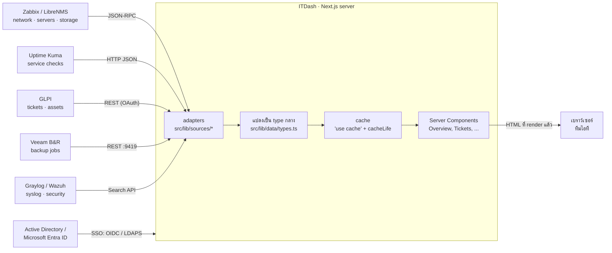
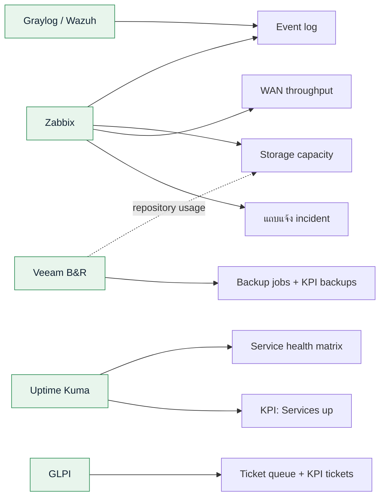
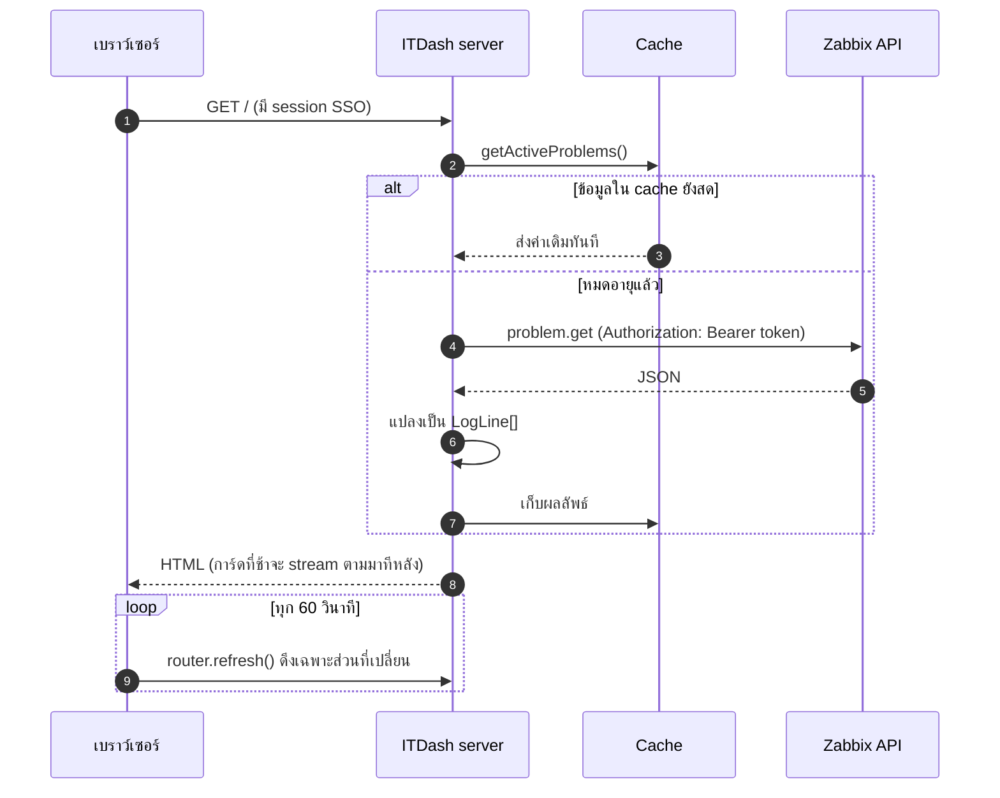
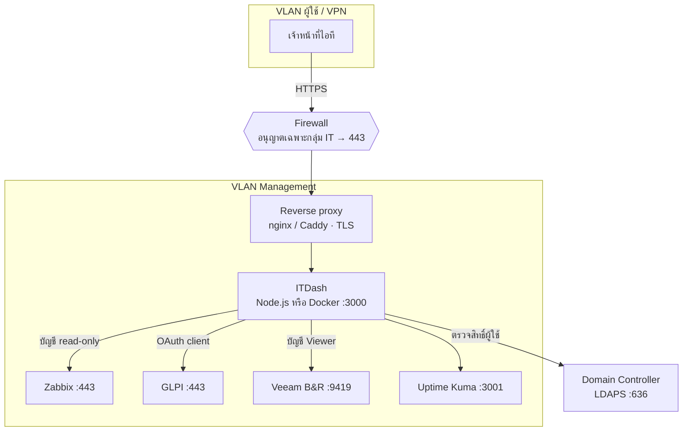
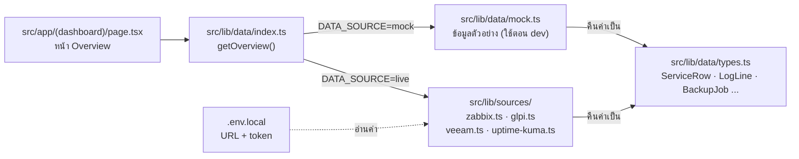

# สถาปัตยกรรม ITDash

เอกสารนี้อธิบายว่าข้อมูลไหลจากระบบต่างๆ ในองค์กรมาถึงหน้า dashboard อย่างไร
(ไดอะแกรมเขียนด้วย Mermaid — GitHub แสดงเป็นรูปให้อัตโนมัติ)

แนวคิดหลักมี 3 ข้อ

1. **ดึงข้อมูลฝั่ง server เท่านั้น** — token / รหัสผ่านของแต่ละระบบอยู่บน server ของ ITDash ไม่หลุดไปถึงเบราว์เซอร์
2. **หนึ่งระบบต้นทาง = หนึ่ง adapter** — adapter แปลงข้อมูลให้อยู่ในรูป type กลาง (`src/lib/data`) หน้าจอจึงไม่ต้องรู้ว่าข้อมูลมาจาก Zabbix หรือ PRTG
3. **cache ตามความสดที่ต้องการ** — สถานะบริการ 30 วินาที, ticket 1 นาที, backup 5–15 นาที, storage รายชั่วโมง ลดภาระของระบบต้นทาง

---

## 1. ภาพรวมระบบ

---

## 2. การ์ดแต่ละใบดึงข้อมูลจากไหน

> ถ้ายังไม่มี Uptime Kuma ใช้ Zabbix Web scenario หรือ trigger ของแต่ละ host แทนได้ — การ์ด Service health เปลี่ยนแค่ adapter

---

## 3. ลำดับการดึงข้อมูลเมื่อเปิดหน้า

ถ้าระบบต้นทางตัวใดล่ม การ์ดใบนั้นแสดง "source unreachable" ส่วนการ์ดอื่นยังทำงานปกติ
(ห่อแต่ละการ์ดด้วย `<Suspense>` + error boundary แยกกัน)

---

## 4. การวางเครื่องในเครือข่าย

- ITDash เปิดเฉพาะภายใน ไม่ต้องเปิดออกอินเทอร์เน็ต
- ทุกการเชื่อมต่อขาออกจาก ITDash เป็น HTTPS และใช้บัญชีที่**อ่านได้อย่างเดียว**
- ถ้าระบบภายในใช้ใบรับรองจาก CA ขององค์กร ให้ตั้ง `NODE_EXTRA_CA_CERTS=/path/to/org-ca.pem` แทนการปิดการตรวจ TLS

---

## 5. โครงโค้ดฝั่งข้อมูล (เป้าหมาย)

สลับระหว่างข้อมูลจำลองกับข้อมูลจริงด้วยตัวแปร `DATA_SOURCE` — ทำให้พัฒนาหน้าจอต่อได้แม้ยังไม่ได้สิทธิ์เข้าระบบจริง

วิธีต่อแต่ละระบบอยู่ใน [INTEGRATIONS.md](./INTEGRATIONS.md)
