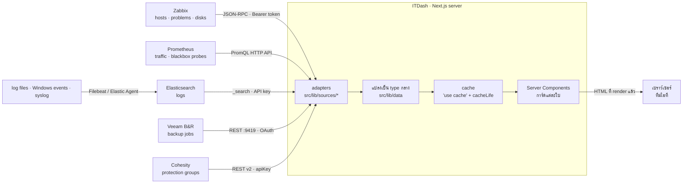
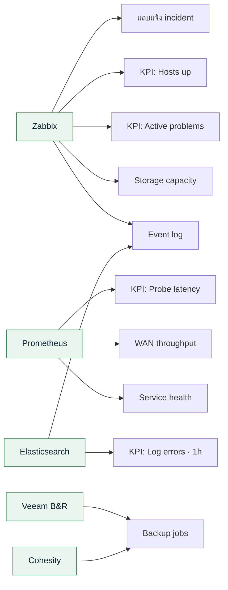
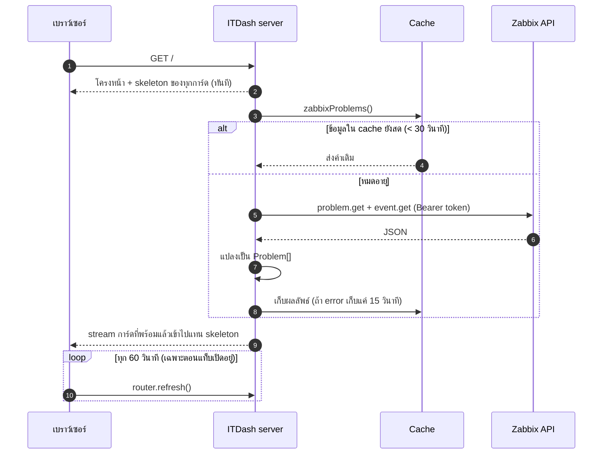
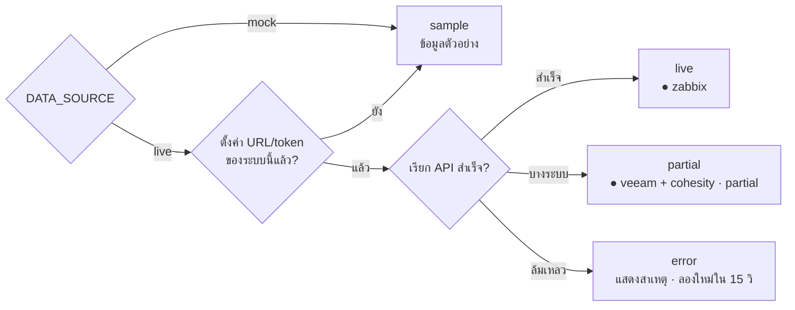
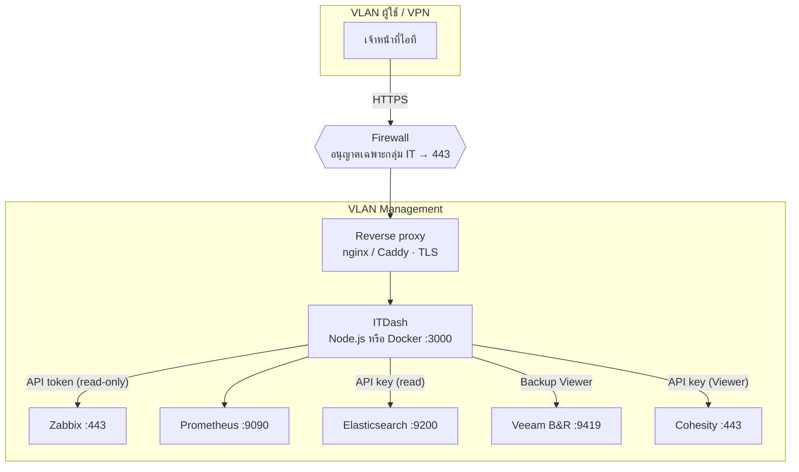
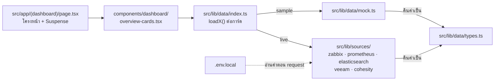

# สถาปัตยกรรม ITDash

ข้อมูลไหลจากระบบต่างๆ ในองค์กรมาถึงหน้า dashboard อย่างไร
(ไดอะแกรมเขียนด้วย Mermaid — GitHub แสดงเป็นรูปให้อัตโนมัติ)

แนวคิดหลัก

1. **ดึงข้อมูลฝั่ง server เท่านั้น** — token / รหัสผ่านอยู่บน server ของ ITDash ไม่ถูกส่งไปเบราว์เซอร์
2. **หนึ่งระบบ = หนึ่ง adapter** (`src/lib/sources/*`) — ทุก adapter คืนค่าเป็น type กลาง (`src/lib/data/types.ts`)
   หน้าจอจึงไม่ต้องรู้ว่าข้อมูลมาจากไหน
3. **cache ตามความสดของข้อมูล** — problem/probe/log 30 วินาที, traffic และ backup 5 นาที, storage 15 นาที
4. **การ์ดแยกกันโหลด** — ระบบไหนช้าหรือล่ม กระทบแค่การ์ดของตัวเอง และแสดงสาเหตุแทนตัวเลขปลอม

---

## 1. ภาพรวมระบบ

---

## 2. การ์ดแต่ละใบดึงข้อมูลจากไหน

---

## 3. ลำดับการดึงข้อมูลเมื่อเปิดหน้า

การ์ด 3 ใบที่ใช้ `problem.get` (แถบ incident, KPI, Event log) ใช้ผลลัพธ์ cache เดียวกัน — Zabbix ถูกเรียกครั้งเดียว

---

## 4. สถานะของการ์ด

---

## 5. การวางเครื่องในเครือข่าย

- ITDash เปิดเฉพาะภายใน ไม่ต้องเปิดออกอินเทอร์เน็ต
- ขาออกจาก ITDash ไปแต่ละระบบใช้บัญชีที่**อ่านได้อย่างเดียว**
- Veeam / Cohesity มักใช้ใบรับรอง self-signed — ตั้ง `NODE_EXTRA_CA_CERTS` แทนการปิดการตรวจ TLS

---

## 6. โครงโค้ดฝั่งข้อมูล

วิธีตั้งค่าแต่ละระบบอยู่ใน [INTEGRATIONS.md](./INTEGRATIONS.md)
