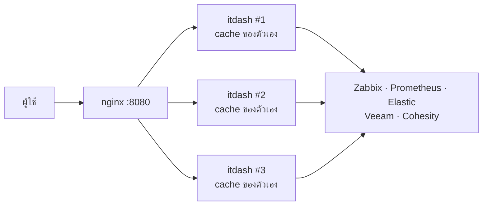

# Deploy ด้วย Docker และการรองรับโหลด

## สรุป

- **1 container พอสำหรับทีมไอที** — วัดได้ ~35 หน้า/วินาที บนเครื่อง 2 vCPU (หน้า Overview เต็มหน้า)
  ผู้ใช้แต่ละคนรีเฟรชทุก 60 วินาที → รองรับผู้เปิดพร้อมกันได้หลายร้อยคน
- **โหลดที่ระบบต้นทางไม่เพิ่มตามจำนวนผู้ใช้** — ในการทดสอบ 697 page load เรียก Zabbix/Prometheus/Elastic/Veeam/Cohesity รวมแค่ 8 ครั้ง (cache)
- เพิ่ม replica เมื่อต้องการ **ความทนทาน** (เครื่องหนึ่งดับอีกเครื่องยังอยู่) มากกว่าเรื่องความเร็ว — และต้องรู้ข้อแลกเปลี่ยนในข้อ 4

---

## 1. Build และรัน (1 instance)

```bash
cp .env.example .env.local            # ใส่ URL + token (ดู docs/INTEGRATIONS.md)
cp /path/to/ca-bundle.pem certs/      # ถ้ามีใบรับรองภายใน/self-signed
docker compose up -d --build
docker compose ps                     # STATUS ต้องเป็น healthy
docker compose logs -f itdash         # ข้อผิดพลาดขึ้นต้นด้วย [itdash]
```

เปิด `http://<host>:3000`

| ไฟล์ | หน้าที่ |
| --- | --- |
| `Dockerfile` | build 3 ขั้น (deps → build → runtime) ได้ image ที่มีแค่ server แบบ standalone, รันด้วย user ที่ไม่ใช่ root, มี healthcheck ที่ `/api/health` |
| `compose.yaml` | 1 instance, อ่าน `.env.local`, mount `./certs`, จำกัด 1 CPU / 1 GB, restart อัตโนมัติ |
| `compose.scale.yaml` | หลาย replica หลัง nginx (ข้อ 3) |
| `deploy/nginx.conf` | load balancer — ปิด buffering เพื่อให้การ์ด stream ทีละใบ |

**แก้ token / URL ไม่ต้อง build ใหม่** — ค่าใน `.env.local` ถูกอ่านตอนรัน แค่ `docker compose up -d` (หรือ `restart`)
**แก้โค้ด** → `docker compose up -d --build`

### ใบรับรอง

`NODE_EXTRA_CA_CERTS=/certs/ca-bundle.pem` ตั้งไว้ใน `compose.yaml` แล้ว — วางไฟล์ไว้ที่ `./certs/ca-bundle.pem`
(โฟลเดอร์นี้ไม่ขึ้น Git) ถ้าไม่มีไฟล์ Node จะเตือนแล้วทำงานต่อ แต่ระบบที่ใช้ใบรับรองภายในจะเชื่อมต่อไม่ได้

### Firewall

Docker Desktop บน Mac และ Docker บน Linux ใช้ NAT — การเชื่อมต่อขาออกจาก container ออกด้วย **IP ของเครื่อง host**
ดังนั้นกฎใน *ITDash Firewall Policy* ใช้ได้เหมือนเดิม ไม่ต้องขอเพิ่ม

### Mac mini (arm64) กับ Linux server (amd64)

image ที่ build บน Mac mini เป็น arm64 ถ้าจะนำไปรันบน server ปกติ (amd64) ให้ build ทั้งสองแบบ:

```bash
docker buildx build --platform linux/arm64,linux/amd64 -t <registry>/itdash:1.0.0 --push .
```

---

## 2. ปรับโหลดก่อนเพิ่มเครื่อง (ทำได้ทันที ไม่ต้องเพิ่ม instance)

| ต้องการ | ทำที่ | ผล |
| --- | --- | --- |
| ลดภาระระบบต้นทาง | `cacheLife` ใน `next.config.ts` เช่น `live` 30 → 60 วินาที | Zabbix/Prometheus ถูกเรียกครึ่งหนึ่ง แลกกับข้อมูลช้าลง 30 วินาที |
| ลดคำขอจากเบราว์เซอร์ | `<AutoRefresh seconds={60}>` ใน `src/app/(dashboard)/page.tsx` เป็น 120 | คำขอเข้า ITDash ลดครึ่งหนึ่ง (เหมาะกับจอ TV ที่เปิดค้าง) |
| รับผู้ใช้มากขึ้นบนเครื่องเดียว | `cpus` / `memory` ใน `compose.yaml` | Node ใช้ CPU ได้ ~1 core ต่อ process — เกิน 1.5 CPU ไม่ช่วย ให้ไปข้อ 3 |
| ระบบต้นทางตอบช้า | `SOURCE_TIMEOUT_MS` | การ์ดที่ช้าจะขึ้น error แทนการค้าง (การ์ดอื่นไม่รอ) |

---

## 3. หลาย replica หลัง load balancer

```bash
docker compose -f compose.yaml -f compose.scale.yaml up -d --build --scale itdash=3
```

เปิด `http://<host>:8080` — nginx กระจายคำขอไปทุก replica (ต้องใช้ Docker Compose 2.24 ขึ้นไป)
เพิ่ม/ลดจำนวน: รันคำสั่งเดิมด้วย `--scale itdash=N` แล้ว `docker compose restart proxy` ให้ nginx เห็น replica ใหม่



---

## 4. ข้อแลกเปลี่ยนเมื่อมีหลาย replica

| เรื่อง | เกิดอะไร | ทางแก้ |
| --- | --- | --- |
| cache ไม่ได้ใช้ร่วมกัน | แต่ละ replica มี cache ในหน่วยความจำของตัวเอง → ระบบต้นทางถูกเรียก **N เท่า** และ 2 แท็บอาจเห็นตัวเลขต่างกันได้ไม่เกินรอบ cache (30 วินาที) | ระยะยาว: ทำ shared cache ด้วย Redis ผ่าน `cacheHandlers` + `'use cache: remote'` (Next.js รองรับ แต่ต้องเขียน handler เพิ่ม) |
| เวอร์ชันไม่ตรงระหว่าง rolling update | replica เก่ากับใหม่ปนกันชั่วคราว → asset หาไม่เจอ | ใช้ image เดียวกันทุก replica และตั้ง `deploymentId` ใน `next.config.ts` ถ้าจะทยอยอัปเดต |
| Session / login (ถ้าเพิ่ม SSO ภายหลัง) | session ต้องอ่านได้จากทุก replica | ใช้ session แบบ JWT/cookie (Auth.js ค่าเริ่มต้น) ไม่ต้องใช้ sticky session |

**แนะนำ:** เริ่มที่ 1 instance ก่อน แล้วดูจากการใช้งานจริง — เพิ่มเป็น 2 replica เมื่อต้องการ high availability
ไม่ต้องทำ shared cache จนกว่าระบบต้นทางจะรับภาระ N เท่าไม่ไหว

---

## ผลการทดสอบ (อ้างอิง)

ทดสอบ server แบบ standalone (ไฟล์เดียวกับที่อยู่ใน image) ต่อกับ server จำลองของทั้ง 5 ระบบ,
`autocannon -c 20 -d 20` ที่หน้า `/` บนเครื่อง 2 vCPU (ใช้ CPU ร่วมกับตัวทดสอบเอง)

| ค่า | ผล |
| --- | --- |
| หน้าเต็มที่ render ได้ | 35 หน้า/วินาที (697 ใน 20 วินาที) |
| latency p50 / p99 | 575 ms / 851 ms ที่ 20 คนพร้อมกัน |
| error | 0 |
| เรียกระบบต้นทางระหว่างทดสอบ | 8 ครั้ง |
| หน่วยความจำหลังทดสอบ | ~420 MB |

ตัวเลขบนเครื่องจริงจะต่างไปตาม CPU และความเร็วของระบบต้นทาง — ทดสอบซ้ำได้ด้วย:

```bash
npx autocannon -c 20 -d 20 http://<host>:3000/
```
