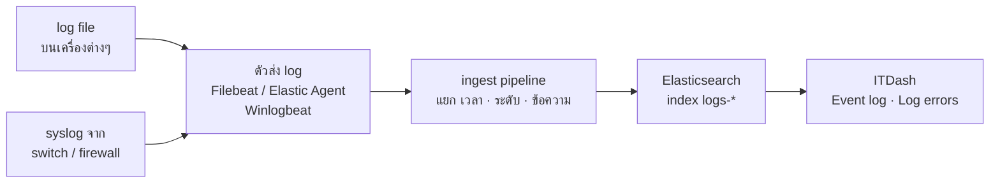

# นำ log file มาแสดงบน ITDash

ITDash **ไม่อ่าน log file โดยตรง** — อ่านจาก Elasticsearch ที่เดียว
ดังนั้น log ทุกไฟล์ต้องถูก **ส่งเข้า Elasticsearch และแยก field ให้ครบ 4 ตัว** ก่อน แล้วจะขึ้นในการ์ด *Event log* และ *Log errors · 1h* เอง โดยไม่ต้องแก้โค้ด



ลำดับงาน: **1** สำรวจ log → **2** เลือกวิธีส่ง → **3** แยก field → **4** ตรวจใน Elasticsearch → **5** ตั้งค่า ITDash

---

## สิ่งที่ ITDash ต้องการจากแต่ละ log (4 field)

| Field | ตัวอย่างค่า | ใช้ทำอะไร | ถ้าไม่มี |
| --- | --- | --- | --- |
| `@timestamp` | `2026-11-05T07:31:07Z` | เรียงเวลา, นับ error ชั่วโมงล่าสุด | log ไม่ขึ้นเลย หรือขึ้นผิดเวลา |
| `log.level` | `error`, `warn`, `info` | เลือกเฉพาะ warn/error มาแสดง, นับ error | log ไม่ขึ้นเลย |
| `message` | `upstream timed out …` | ข้อความในบรรทัด (แสดงเฉพาะบรรทัดแรก) | บรรทัดว่าง |
| `host.name` | `app-03` | คอลัมน์ต้นทาง | แสดงเป็น `elastic` |

ชื่อ field เปลี่ยนได้ด้วย `ES_TIME_FIELD`, `ES_LEVEL_FIELD`, `ES_MESSAGE_FIELD`, `ES_SOURCE_FIELD` แต่**แนะนำให้ใช้ชื่อตามนี้ (ECS)** เพราะเครื่องมือของ Elastic ใช้อยู่แล้ว

ระดับที่ ITDash นับ (ไม่สนตัวพิมพ์เล็ก/ใหญ่):

| ระดับ | ค่าใน `log.level` | แสดงเป็น |
| --- | --- | --- |
| วิกฤต | `error` `err` `crit` `critical` `fatal` `alert` `emerg` `emergency` | **CRIT** + นับใน Log errors |
| เตือน | `warn` `warning` | **WARN** |
| อื่นๆ | `info` `notice` `debug` … | ไม่แสดงใน Event log |

---

## ขั้นที่ 1 — สำรวจ log ที่มี

ทำตารางนี้ให้ครบก่อนเริ่ม (ตัวอย่าง 3 แถวแรก):

| log | เครื่อง | path / แหล่ง | รูปแบบ | มีระดับไหม | เวลาเป็นโซนไหน |
| --- | --- | --- | --- | --- | --- |
| e-Office app | app-03 | `/var/log/eoffice/*.log` | ข้อความ `2026-11-05 14:31:07 [ERROR] …` | มี | เวลาไทย ไม่มี +07:00 |
| HR API | app-05 | `/opt/hr/logs/app.json` | JSON บรรทัดละ 1 รายการ | มี (`"level"`) | UTC |
| Core switch | sw-core-01 | syslog UDP 514 | syslog | มี (severity) | เวลาไทย |

คำถามที่ต้องตอบให้ได้ต่อ 1 log:
- **รูปแบบ** — ข้อความธรรมดา / JSON / syslog / Windows Event / log ของ IIS-Nginx-Apache
- **มีคำบอกระดับในแต่ละบรรทัดไหม** — ถ้าไม่มี ข้ามไปดู "log ที่ไม่มีระดับ" ท้ายเอกสาร
- **ขึ้นหลายบรรทัดไหม** (stack trace) — ต้องตั้ง multiline
- **เวลาในไฟล์มีโซนเวลาไหม** — ถ้าไม่มี ต้องบอก Elasticsearch ว่าเป็นเวลาไทย (ขั้นที่ 3)

---

## ขั้นที่ 2 — เลือกวิธีส่งเข้า Elasticsearch

| แหล่ง log | ใช้ | ได้ `log.level` เองไหม |
| --- | --- | --- |
| log ไฟล์ของแอป (ข้อความธรรมดา) | Filebeat `filestream` หรือ Elastic Agent *Custom Logs* + ingest pipeline (ขั้นที่ 3) | ไม่ได้ — ต้องแยกเอง |
| log ไฟล์แบบ JSON | Filebeat `filestream` + parser `ndjson` | ได้ ถ้า JSON มี field ระดับ (อาจต้องเปลี่ยนชื่อ) |
| Windows Event Log | Winlogbeat หรือ Elastic Agent *Windows* integration | ได้ |
| syslog จาก switch / firewall | Elastic Agent *Custom UDP/TCP* หรือ integration ของยี่ห้อนั้น (Cisco, Fortinet ฯลฯ) | ส่วนใหญ่ได้ — ตรวจในขั้นที่ 4 |
| IIS / Nginx / Apache | integration หรือ Filebeat module ของแต่ละตัว | access log ไม่มีระดับ (ไม่ต้องขึ้น Event log) · error log มี |

**ใช้ index เริ่มต้นของแต่ละเครื่องมือ อย่าตั้งชื่อเอง** — template ของมันตั้ง `log.level` เป็น `keyword` ไว้แล้ว ซึ่ง ITDash ต้องใช้

| เครื่องมือ | index ที่ได้ | ใส่ใน `ES_INDEX` |
| --- | --- | --- |
| Elastic Agent | `logs-*` | `logs-*` (ค่าเริ่มต้นของ ITDash) |
| Filebeat | `filebeat-*` | เพิ่ม `filebeat-*` |
| Winlogbeat | `winlogbeat-*` | เพิ่ม `winlogbeat-*` |

เช่นใช้ทั้งสามแบบ: `ES_INDEX=logs-*,filebeat-*,winlogbeat-*` (และ API key ของ ITDash ต้องอ่านได้ทั้งสาม pattern)

### ตัวอย่าง Filebeat (log ข้อความธรรมดา)

```yaml
filebeat.inputs:
  - type: filestream
    id: eoffice-app
    paths: ["/var/log/eoffice/*.log"]
    pipeline: itdash-applog          # ingest pipeline ในขั้นที่ 3
    parsers:
      - multiline:                   # รวม stack trace เข้ากับบรรทัดที่ขึ้นต้นด้วยวันที่
          type: pattern
          pattern: '^\d{4}-\d{2}-\d{2}'
          negate: true
          match: after
    fields_under_root: true
    fields:
      service.name: eoffice

  - type: filestream
    id: hr-api-json
    paths: ["/opt/hr/logs/app.json"]
    parsers:
      - ndjson:
          target: ""
          add_error_key: true
          overwrite_keys: true

output.elasticsearch:
  hosts: ["https://elastic.example.local:9200"]
  api_key: "<id>:<api_key>"          # key สำหรับเขียน — คนละตัวกับของ ITDash
  # ไม่ต้องตั้ง index — ใช้ค่าเริ่มต้น filebeat-* พร้อม template ของ Filebeat
```

รัน `filebeat test config` และ `filebeat test output` ก่อน start service

---

## ขั้นที่ 3 — แยก field ด้วย ingest pipeline

ทำใน Kibana → *Dev Tools* ตัวอย่างนี้สำหรับบรรทัดรูปแบบ `2026-11-05 14:31:07 [ERROR] ข้อความ` ที่เป็นเวลาไทย

```json
PUT _ingest/pipeline/itdash-applog
{
  "description": "ITDash: แยกเวลา ระดับ ข้อความ จาก log แอป",
  "processors": [
    { "grok": {
        "field": "message",
        "patterns": ["^%{TIMESTAMP_ISO8601:log_time} \\[%{LOGLEVEL:log.level}\\] %{GREEDYDATA:message}"],
        "ignore_failure": true } },
    { "date": {
        "field": "log_time",
        "formats": ["yyyy-MM-dd HH:mm:ss", "yyyy-MM-dd HH:mm:ss.SSS", "ISO8601"],
        "timezone": "Asia/Bangkok",
        "target_field": "@timestamp",
        "ignore_failure": true } },
    { "lowercase": { "field": "log.level", "ignore_missing": true } },
    { "remove": { "field": "log_time", "ignore_missing": true } }
  ]
}
```

**ทดสอบ pipeline ก่อนใช้จริง** — ส่งบรรทัดตัวอย่างจากไฟล์จริงเข้าไป ดูว่าได้ field ครบและเวลาถูก:

```json
POST _ingest/pipeline/itdash-applog/_simulate
{
  "docs": [
    { "_source": { "message": "2026-11-05 14:31:07 [ERROR] upstream timed out (110: Connection timed out)" } }
  ]
}
```

ผลที่ถูกต้อง: `log.level` = `error`, `message` เหลือแค่ข้อความ, `@timestamp` = `2026-11-05T07:31:07.000Z` (= 14:31 เวลาไทย)

**แก้ pipeline ตามรูปแบบ log ของคุณ**

| รูปแบบในไฟล์ | pattern ของ grok |
| --- | --- |
| `2026-11-05 14:31:07 [ERROR] msg` | `^%{TIMESTAMP_ISO8601:log_time} \[%{LOGLEVEL:log.level}\] %{GREEDYDATA:message}` |
| `2026-11-05 14:31:07 ERROR msg` | `^%{TIMESTAMP_ISO8601:log_time} %{LOGLEVEL:log.level} %{GREEDYDATA:message}` |
| `[05/Nov/2026:14:31:07 +0700] ERROR msg` | `^\[%{HTTPDATE:log_time}\] %{LOGLEVEL:log.level} %{GREEDYDATA:message}` (date format `dd/MMM/yyyy:HH:mm:ss Z`) |
| JSON ที่ใช้ `"level"` แทน `log.level` | ไม่ต้อง grok — ใช้ `{ "rename": { "field": "level", "target_field": "log.level" } }` |
| syslog ที่ได้ `log.syslog.severity.name` | `{ "set": { "field": "log.level", "copy_from": "log.syslog.severity.name" } }` |

**เรื่องเวลา (พลาดบ่อยที่สุด)** — ถ้าเวลาในไฟล์ไม่มี `+07:00` และไม่ได้ใส่ `"timezone": "Asia/Bangkok"`
Elasticsearch จะถือว่าเป็น UTC → log ใน ITDash จะ**เลื่อนไป 7 ชั่วโมง** และการ์ด Log errors · 1h จะนับผิดชั่วโมง

---

## ขั้นที่ 4 — ตรวจใน Elasticsearch

1. **มี log ที่ระดับ warn/error เข้ามาไหม**

   ```json
   GET logs-*/_search
   {
     "size": 3,
     "sort": [{ "@timestamp": "desc" }],
     "_source": ["@timestamp", "log.level", "message", "host.name"],
     "query": { "terms": { "log.level": ["error", "warn", "warning"] } }
   }
   ```

   ต้องได้เอกสารที่มีครบ 4 field และเวลาล่าสุดตรงกับนาฬิกา (ลบ 7 ชั่วโมงเพราะแสดงเป็น UTC)

2. **`log.level` เป็น keyword ไหม**

   ```json
   GET logs-*/_mapping/field/log.level
   ```

   ต้องเป็น `"type": "keyword"` — ถ้าเป็น `text` (index ที่ตั้งชื่อเองจึงไม่มี template) ITDash จะหาไม่เจอ
   แก้โดยกลับไปใช้ index เริ่มต้นของเครื่องมือ หรือตั้ง `ES_LEVEL_FIELD=log.level.keyword`
   (ตรวจทุก pattern ที่ใส่ใน `ES_INDEX` เช่น `GET filebeat-*/_mapping/field/log.level`)

3. **API key ของ ITDash อ่าน index นี้ได้ไหม** — ทุก pattern ใน `ES_INDEX` ต้องอยู่ใน `names` ของ API key
   (คู่มือตั้งค่าการเชื่อมต่อ หัวข้อ 4)

---

## ขั้นที่ 5 — ตั้งค่า ITDash

ส่วนใหญ่ไม่ต้องแก้อะไรถ้าทำตามขั้น 1–4 — ค่าเริ่มต้นอ่าน `logs-*` ด้วย field ECS อยู่แล้ว ปรับเฉพาะกรณีนี้ใน `.env.local` แล้ว restart

| ต้องการ | ตัวแปร | ตัวอย่าง |
| --- | --- | --- |
| อ่านหลาย index | `ES_INDEX` | `logs-*,winlogbeat-*` |
| ตัด log ที่ไม่สำคัญออก | `ES_FILTER` | `NOT service.name:nginx-access AND NOT message:"health check"` |
| แสดงชื่อแอปแทนชื่อเครื่อง | `ES_SOURCE_FIELD` | `service.name` |
| นับ warning เป็น error ด้วย | `ES_ERROR_LEVELS` | `error,crit,fatal,warn,warning` |
| ใช้ชื่อ field อื่น | `ES_LEVEL_FIELD` ฯลฯ | `level` |

เปิด ITDash → การ์ด *Event log* ต้องเห็นบรรทัดจาก log ใหม่ (ภายใน 30 วินาที) และป้ายมุมขวาเป็น `● zabbix + elastic`

---

## log ที่ไม่มีระดับ

บาง log บอกแค่ข้อความ เช่น `Connection refused to db-01` — ITDash เลือก log ด้วย `log.level` เสมอ
(ใส่แค่ `ES_FILTER` อย่างเดียวจะไม่ขึ้น) จึงต้องเติมระดับให้ก่อนเข้า Elasticsearch อย่างใดอย่างหนึ่ง:

1. **ให้ pipeline เติมระดับจากคำในข้อความ** (แนะนำ) — เพิ่มต่อท้าย processors ใน pipeline ของขั้นที่ 3:

   ```json
   { "set": { "field": "log.level", "value": "error",
              "if": "ctx.log?.level == null && ctx.message != null && ctx.message =~ /(?i)(error|fail|refused|timeout|denied)/" } },
   { "set": { "field": "log.level", "value": "info", "if": "ctx.log?.level == null" } }
   ```

   ทดสอบด้วย `_simulate` เหมือนขั้นที่ 3 · regex ใน Painless ใช้ได้ตามค่าเริ่มต้นของ Elasticsearch 8 (`script.painless.regex.enabled: limited`)

2. **ไม่ผ่าน Elastic เลย** — ถ้ามีแค่ไม่กี่ไฟล์และสนใจแค่บางคำ ใช้ Zabbix item `logrt[/path/*.log,"ERROR|FATAL"]` + trigger
   ปัญหาจะขึ้นในแถบ incident และ Event log ของ ITDash เหมือน problem อื่นของ Zabbix (แต่ค้นย้อนหลังไม่ได้แบบ Elastic)

## Checklist

- [ ] ทำตารางสำรวจ log ครบ (ขั้นที่ 1)
- [ ] ติดตั้งตัวส่ง log บนทุกเครื่อง / ชี้ syslog ไปที่ Elastic Agent
- [ ] ingest pipeline ผ่าน `_simulate` ด้วยบรรทัดจริง — เวลาเป็นเวลาไทยที่ถูกต้อง
- [ ] ใช้ index เริ่มต้นของเครื่องมือ, `ES_INDEX` ครอบคลุมทุก pattern และ `log.level` เป็น `keyword`
- [ ] API key ของ ITDash อ่าน index นั้นได้
- [ ] ตั้งอายุเก็บ log (ILM เช่น 30–90 วัน) ไม่ให้ดิสก์ของ Elasticsearch เต็ม
- [ ] เห็นบรรทัดใหม่ในการ์ด Event log ของ ITDash
